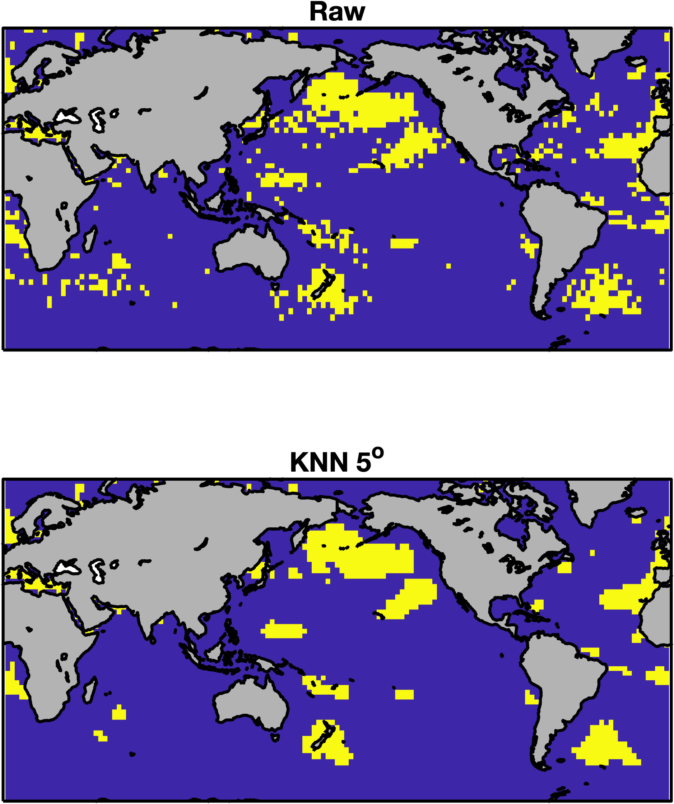

# Heatwave Tracking and Normalizing
This package provides methods to track and normalize heatwave (HW) objects. It enables the identification, tracking, and unification of extreme events across spatial and temporal scales.
By mapping multiscale HW events into a unified structural framework, this method allows direct comparison of event dynamics.
Its applications are not limited to HWs and MHWs, but can also be extended to other extremes such as precipitation and drought.

## Tracking - `mhwtrack.m`  
The tracking method to identify and track spatially contiguous extremes that allows nouniform lon-lat grids.  
```
%Example
tracks = mhwtrack(lon_used, lat_used, hw_ts, nums);
```
Here, `lon_used` and `lat_used` are 1D vectors representing the longitudes and latitudes of the input data, respectively. `hw_ts` is a 3D binary field [lon, lat, time], where a value of 1 indicates the presence of a temperature extreme event and 0 indicates its absence. `nums` defines the minimum number of pixels required for a detected object. The output `tracks` contains the spatiotemporal trajectories of tracks.

## Normalizing - `spn.m`  
Analyzing track entities as sequences of moving objects from a composite perspective is substantially more challenging than interpreting fixed-grid outputs, as each event exhibits distinct spatiotemporal dynamics, with evolving shapes, sizes, and durations. To overcome this issue, we develop a normalization method that scales the entities in space and time so that they can be more directly compared. To compare the spatiotemporal evolution of individual tracks, we normalize their shapes to fit within a unit circle (radius = 1) and standardize their durations from t=0 (onset) to t=1 (end). Specifically, we first compute the centroid of each track at every time step and identify the maximum distance (r) from these centroids to their outermost boundaries over the event's entire lifespan. Subsequently, we reposition each objects by translating all grid points so that the centroid aligns with the origin, and scale spatial dimensions uniformly by a factor 1/r to constrain the maximum radius within unity. Pixels covered by land remain blank in this and future composite process.  
```
%Example
[radius_s,sst_sp,sst_spn_full,x_full,y_full]=spn(tracks,lon_used,lat_used,data_anom);
``` 

Examples of an output  


## Smoothing
Spatial incoherence is commonly observed in extreme events identified from raw data. Therefore, spatial smoothing is typically applied to refine connected extreme objects in 2D maps. This step helps regularize object shapes while removing fragmented small-scale features, making subsequent tracking more meaningful and practically applicable. An example of this process at a given spatial scale can be found in this [example](https://github.com/ZijieZhaoMMHW/MHW_tracking/blob/main/example_used.m).



## Example
A very rough and unpolished example for tracking and normalizing can be found [here](https://github.com/ZijieZhaoMMHW/MHW_tracking/blob/main/example.md). Better documentions and more examples will be included later.

## Quirks
Based on my current experiences, some quirks can happen during trackings.

1. Even after spatial smoothing, some patches smaller than the smoothing scale can still show up. The `nums` parameter lets you set the minimum number of connected grid cells a patch needs before it can be tracked. For example, [Sun et al. (2023)](https://doi.org/10.1016/j.pocean.2022.102947) used 5° KNN smoothing on a 0.25° grid and then dropped patches with fewer than 441 connected grid cells, or `(5 / 0.25 + 1)²`. You can see the cutoff in [their code](https://github.com/cindyisok/MHWTracking/blob/60781455b95a2f5b2ff7d816682861db37a51cf9/code/conn.m#L7-L16).

   This matters because 441 cells on a regular latitude–longitude grid cover more ocean near the equator than at higher latitudes. So near the equator, a patch has to be physically larger to make the cut. That’s worth keeping in mind when looking at the large equatorial events in [Sun et al. (2023)](https://doi.org/10.1016/j.pocean.2022.102947) and [Zhang et al. (2026)](https://doi.org/10.1038/s41612-026-01592-5), alongside differences in local ocean dynamics.

   A similar issue could come up in the Tasman Sea. [Zhao et al. (2026)](https://doi.org/10.1038/s41598-026-40354-4) found that advection dominates at many individual grid cells, yet they counted fewer advection-driven events than surface-heat-flux-driven events. If advection tends to produce smaller, more isolated patches, a size cutoff could leave quite a few of them out of the track count, even if they cover relatively little area.
   
2. The current merging can cause two events stick together for awhile then suddenly merging into 1 for some events. Still exploring how to better resolve this....

